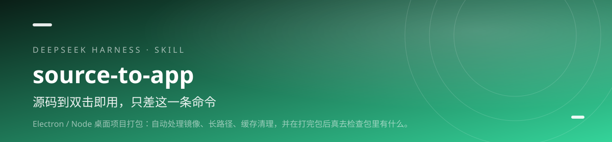

<div align="center">



<h1>source-to-app · 源码打包</h1>

<p><b>源码到双击即用，只差这一条命令。</b></p>

<p>Electron / Node 桌面项目打包：自动处理镜像、长路径、缓存清理，并在打完包后真去检查包里有什么。</p>

[](https://github.com/lilinshuei/source-to-app/actions/workflows/validate.yml)
[](LICENSE)
[](https://www.npmjs.com/package/source-to-app)
[](https://github.com/topics/dsh-plugin)
[](#环境要求)

</div>

---

## 它解决什么问题

开发时 npm run dev 一切正常，不代表别人双击就能用。把仓库交给不懂技术的人，中间隔着镜像下载、Windows 260 字符路径、构建清缓存被拦、关键文件静默漏打这些坑。

这个 Skill 把这段路拆成三步：10 秒体检、一条命令打包、打完真去验货。它不看“命令没报错”就宣布成功，而是检查文件数、体积、关键文件在不在、包里的代码是不是新的。

## 你会得到什么

- **10 秒体检** — Node 版本、磁盘、路径长度、镜像、包管理器、上次残留，开打前先暴露问题。
- **自动处理环境坑** — 国内镜像、长路径跳板、缓存清理被拦，都有对应处理，不用手记环境变量。
- **一条命令打包** — 预检 → 配置 → 构建 → 打包，中间不用盯。
- **产物真校验** — 文件数、总体积、关键文件是否存在、app.asar 里的代码是否新鲜。
- **安全可回退** — 挪走的目录进暂存区而不是直接删；安全开关只限定在构建子进程内。

## 安装

### npm 一行安装（推荐）

```powershell
dsh plugin --profile web add source-to-app
```

在 DSH 桌面端的「添加插件」窗口里，只填包名 `source-to-app`，不要粘贴整条命令。

包已发布到 npm registry，命令最短，也不依赖 GitHub 访问。桌面端把 `web` 换成 `desktop`；装完重启 DSH，新会话即可调用。

### 从 GitHub 安装

```powershell
dsh plugin --profile web add github:lilinshuei/source-to-app
```

想跟最新提交，或 npm 拉取不畅时用这条。

### 手动安装

```bash
git clone https://github.com/lilinshuei/source-to-app.git
mkdir -p ~/.dsh/skills
cp -r source-to-app ~/.dsh/skills/
```

最终路径是 `~/.dsh/skills/source-to-app/SKILL.md`。仓库根目录就是 Skill 本体，不用再找子目录。

## 快速上手

### 1. 先体检

```bash
node scripts/preflight.mjs --project-root <项目根>
```

✓ 通过 / ! 警告 / ✗ 阻塞；10 秒内知道能不能开打。

### 2. 再打包

```bash
node scripts/package.mjs --project-root <项目根> --desktop-dir apps/desktop --mode dir
```

给内部测试用 dir；给客户再按体积决定是否做安装程序。

### 3. 最后验货

```bash
node scripts/verify-artifact.mjs --artifact <产物目录> --expect resources/模型文件.bin
```

不要只看退出码；关键文件与代码新鲜度都要查。

## 能力边界

- 它不会修复项目本身的业务代码错误，只处理打包链路上的环境与配置问题。
- 超过 2GB 的安装包不建议用 NSIS；脚本会提示，但方案要你拍板。
- 不提供代码签名证书，也不绕过 SmartScreen。
- 请只打包自己拥有或已获授权的项目与素材。

## 环境要求

| 项 | 要求 |
|---|---|
| 运行环境 | Node.js ≥ 18 |
| 项目类型 | Electron / Node 桌面项目 |
| 操作系统 | Windows 优先；其他平台按脚本文档调整 |
| 签名证书 | 不内置；需要签名时自行提供 |

## 仓库里有什么

```
source-to-app/
├── scripts/preflight.mjs
├── scripts/package.mjs
├── scripts/verify-artifact.mjs
├── references/pitfalls.md
├── lib/index.js          # DSH 插件适配层（零依赖）
├── cordis.patch.yml      # DSH 挂载声明
├── tools/                # 仓库自检 + 适配层冒烟测试
└── README.md
```

- scripts/preflight.mjs — 开打前环境体检
- scripts/package.mjs — 镜像、长路径、缓存与构建编排
- scripts/verify-artifact.mjs — 产物文件、体积与代码新鲜度校验
- references/pitfalls.md — 按报错症状查原因与处理

## 安全与隐私

- **零遥测**：不上报使用数据、不内置统计、不访问外部接口。
- **本地执行**：所有处理都在你的机器上完成；需要联网时只发生在你自己执行的包管理器或下载命令里。
- **不删文件**：仓库脚本以“只新增、不删除”为约束；需要清理时会先说明并留回退路径。
- **无凭据**：仓库不包含账号、令牌、Cookie 或本机绝对路径。发现问题请按 [SECURITY.md](SECURITY.md) 私下报告。

## 同系列 Skill

| Skill | 一句话 |
|---|---|
| **[novel-atlas](https://github.com/lilinshuei/novel-atlas)** | 把一本小说，变成一座可以走进去的世界。 |
| **[pc-privacy-shield](https://github.com/lilinshuei/pc-privacy-shield)** | 你的屏幕看得见，别人的截屏看不见。 |
| **[blank-workbench](https://github.com/lilinshuei/blank-workbench)** | 一句话，得到一个能直接干活的工作台。 |
| **[task-complete-chime](https://github.com/lilinshuei/task-complete-chime)** | 任务跑完了，别再盯着屏幕等。 |
| **[phone-media-transfer-android-app](https://github.com/lilinshuei/phone-media-transfer-android-app)** | App 说找不到文件夹？那就从电脑直接送进去。 |

## License

MIT © 2026 lilinshuei。本 Skill 为原创设计；第三方依赖与素材在各自目录内单独标注。

---

如果它替你省下了时间，点一个 **Star**，让更多人找到它。
